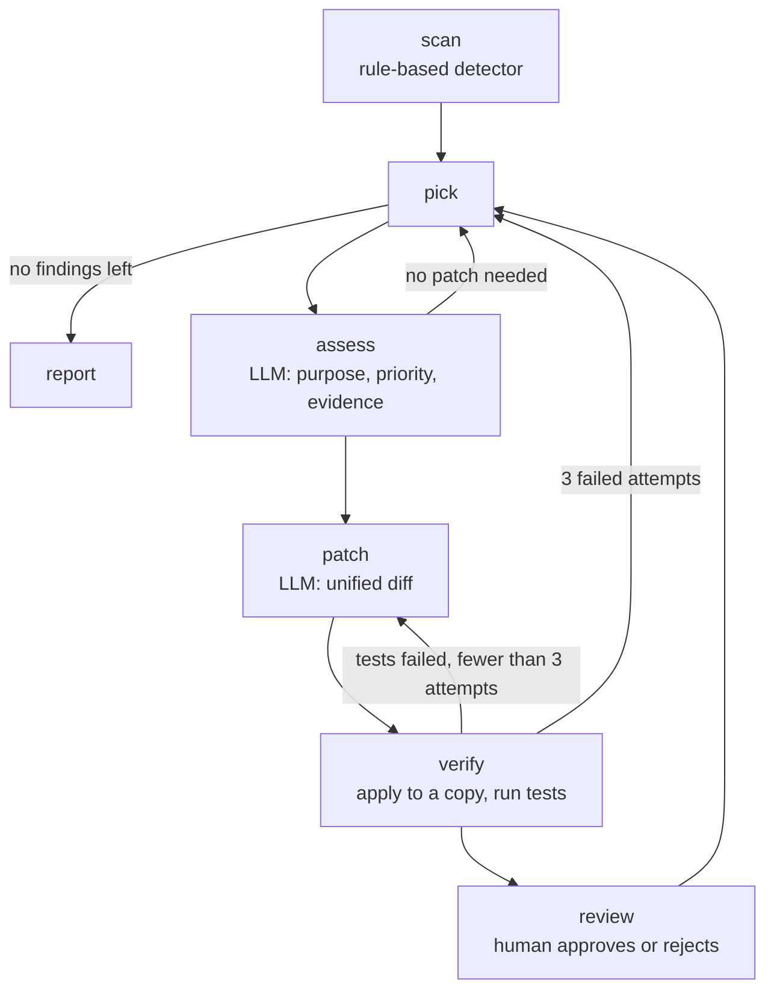

# pqc-scout

A migration assistant that helps move Python projects to post-quantum cryptography.

> **Status: early development, stage 0 (project scaffolding).** Everything below describes planned functionality, not what works today. Progress is tracked in the [roadmap](docs/ROADMAP.md).

## Why

A large enough quantum computer will break RSA and elliptic-curve cryptography, which today secure key exchange, certificates and digital signatures. No such computer exists yet, but encrypted traffic can be recorded now and decrypted later. That is why the industry is moving to ML-KEM and ML-DSA, the post-quantum algorithms NIST standardized in 2024. Under the draft NIST IR 8547, quantum-vulnerable algorithms are phased out between 2030 and 2035.

The first and most labor-intensive step of that migration is a cryptographic inventory: finding every place in code and configuration where vulnerable cryptography is used, and understanding what each one protects. pqc-scout automates this step for Python projects.

## What it will do

`pqc-scout scan <path>` will find RSA, DSA, DH and elliptic-curve cryptography in code that uses `cryptography`, `pycryptodome` or `PyJWT`, as well as in key and certificate files. Results are exported as a CycloneDX CBOM. The scan is rule-based and deterministic: no LLM involved.

`pqc-scout analyze <path>` will go through each finding, work out from the surrounding code what it protects, rate how urgent the migration is and suggest a replacement with ML-KEM or ML-DSA. Every conclusion will cite lines of code and the relevant standards. For code on `cryptography` it will also generate a patch, run the tests against it, and apply it only after a human approves.

## How it works

The analysis is a [LangGraph](https://github.com/langchain-ai/langgraph) graph. The detector is a plain rule-based node; language models are used only where understanding the context is required. Findings are processed one at a time, and the run is checkpointed to SQLite, so an interrupted analysis resumes where it stopped.



Planned stack: Python 3.12, uv, LangGraph, LangChain (model interface, tool calling, structured output), Ollama for local models, GigaChat as a cloud option, pydantic, typer, pytest, GitHub Actions.

## Documentation

The project documentation is written in Russian.

- [Roadmap](docs/ROADMAP.md): scope, architecture, risk model, stages and workflow.
- [Glossary](docs/GLOSSARY.md): cryptography, project and LangGraph terms explained.

## Development

The project is managed with [uv](https://docs.astral.sh/uv/).

```
uv sync
uv run ruff check
uv run pytest
uv run pqc-scout --help
```

## License

[MIT](LICENSE)
